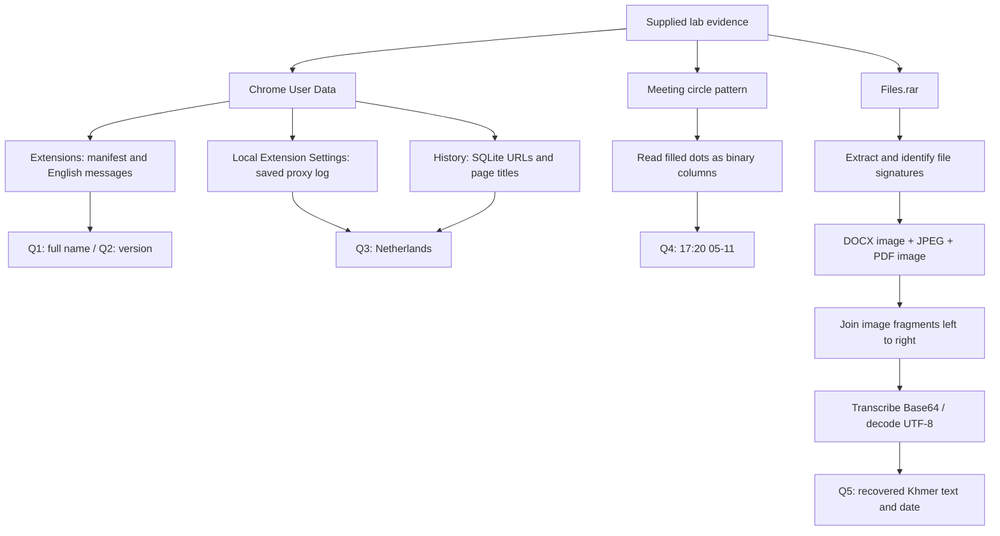

# Browser Forensics Lab — Q1 to Q5

This walkthrough starts with an extracted Chrome `User Data` directory and a separate `Files.rar` archive. It explains how to identify an installed VPN, establish its version and selected country, read the meeting pattern, and recover an encoded message from files with misleading extensions.

## Answers

| Question | Answer |
|---|---|
| Q1 — full VPN extension name | **Browsec VPN - Free VPN for Chrome** |
| Q2 — installed extension version | **3.60.0** |
| Q3 — VPN country | **Netherlands** |
| Q4 — meeting time and date (`HH:MM DD-MM`) | **17:20 05-11** |
| Q5 — decoded string | **វិមានឯករាជ្យ9Nov** |

The Q5 text means **Independence Monument, 9 November**. Submit the exact decoded text if the quiz expects a string. Q4 and Q5 are separate answers: do not replace Q4's date with Q5's date.

## 1. Starting point and tools

The files used in this lab are arranged as follows:

```text
/home/Panha/CTF/ReverseEngineer/Browser_Forensic/
├── Browser Violation.zip
├── Files.rar
└── User Data/                         ← already extracted browser evidence
    ├── Local State
    └── Default/
        ├── History                    ← SQLite browsing history
        ├── Preferences
        ├── Extensions/                ← installed extension code and metadata
        └── Local Extension Settings/  ← extension storage and diagnostic records
```

The original browser archive was already extracted when this investigation started. These instructions use that existing extraction. Do not launch Chrome against the evidence profile: Chrome can change its files.

Commands below use Bash and Python 3. `file` identifies formats from their contents; `unrar` extracts the archive; Pillow reads and joins the picture fragments; `pdftoppm` renders the PDF. On a Debian/Ubuntu system that lacks these tools, install them yourself with:

```bash
sudo apt update
sudo apt install python3 python3-pil file unrar poppler-utils ripgrep
```

Set the paths once. Quote paths because `User Data` contains a space:

```bash
export LAB='/home/Panha/CTF/ReverseEngineer/Browser_Forensic'
export PROFILE="$LAB/User Data"
export EXTID='omghfjlpggmjjaagoclmmobgdodcjboh'
cd "$PROFILE"
```

Work on copies for a formal forensic examination. Here, analysis reads the extracted profile and writes generated material to a separate folder. The SQLite commands explicitly open the history database in read-only mode. Hashes can help document the inputs before analysis:

```bash
sha256sum "$LAB/Files.rar" "$PROFILE/Default/History"
```

## 2. Investigation flow and evidence architecture



The Chrome extension ID connects two evidence sources. `Extensions/<ID>/` contains the installed program and its manifest. `Local Extension Settings/<ID>/` contains that extension's saved data. Browser history provides independent context for the selected country. The meeting pattern and the RAR archive are separate puzzle inputs.

## 3. Q1 — Find the full VPN extension name

### Locate installed manifests

```bash
find "$PROFILE/Default/Extensions" -name manifest.json -print
```

An extension manifest describes an extension's name, version, permissions, and other metadata. Inspect all installed extensions rather than assuming every extension is a VPN:

```bash
python3 - <<'PY'
import json, os
from pathlib import Path
root = Path(os.environ['PROFILE']) / 'Default/Extensions'
for path in sorted(root.glob('*/*/manifest.json')):
    data = json.loads(path.read_text())
    print(path)
    print('  name:', data.get('name'))
    print('  short_name:', data.get('short_name'))
    print('  version:', data.get('version'))
PY
```

The VPN is under extension ID `omghfjlpggmjjaagoclmmobgdodcjboh`. Its manifest includes:

```json
"name": "__MSG_extension_name_chrome__",
"short_name": "Browsec VPN",
"version": "3.60.0"
```

`__MSG_extension_name_chrome__` is a translation lookup key, not the display name. Follow the key into the English language file:

```bash
python3 - <<'PY'
import json, os
from pathlib import Path
path = (Path(os.environ['PROFILE']) / 'Default/Extensions' /
        os.environ['EXTID'] / '3.60.0_0/_locales/en/messages.json')
messages = json.loads(path.read_text())
print(messages['extension_name_chrome']['message'])
PY
```

Output:

```text
Browsec VPN - Free VPN for Chrome
```

**Q1 answer: `Browsec VPN - Free VPN for Chrome`**

Technique: resolve localized manifest values to obtain the exact full display name. The short name alone would omit part of the answer.

## 4. Q2 — Determine the installed version

Read the manifest's `version` field:

```bash
python3 - <<'PY'
import json, os
from pathlib import Path
path = (Path(os.environ['PROFILE']) / 'Default/Extensions' /
        os.environ['EXTID'] / '3.60.0_0/manifest.json')
print(json.loads(path.read_text())['version'])
PY
```

Output:

```text
3.60.0
```

The enclosing folder is `3.60.0_0`, but the manifest's installed version is **`3.60.0`**. Do not include `_0` in the answer. The saved extension data also records `installVersion` as `3.60.0`.

**Q2 answer: `3.60.0`**


*Rendered transcript of the actual manifest and English message values, collected from the supplied profile. These evidence panels are generated from command output; they are not screenshots of a running Chrome session.*

## 5. Q3 — Establish the VPN country

### Read the saved extension log

The extension's saved storage is here:

```text
Default/Local Extension Settings/omghfjlpggmjjaagoclmmobgdodcjboh/000003.log
```

This is a binary LevelDB log, so ordinary text display can be noisy. For this lab, its diagnostic messages contain readable JSON strings. Extract a small relevant section:

```bash
python3 - <<'PY'
import os, re
from pathlib import Path
path = (Path(os.environ['PROFILE']) / 'Default/Local Extension Settings' /
        os.environ['EXTID'] / '000003.log')
text = path.read_bytes().decode('utf-8', errors='replace')
text = text.replace('\\"', '"')
pattern = r'"country":"nl","filters":\[\],"mode":"proxy"'
match = re.search(pattern, text)
print(match.group() if match else 'Pattern not found')
PY
```

Recovered evidence:

```text
"country":"nl","filters":[],"mode":"proxy"
```

The country code `nl` means Netherlands. The surrounding record describes a transition from direct mode to proxy mode, tying the country to an enabled proxy configuration.

Do not infer the selected country merely because a server list mentions a country. Server lists contain many available locations. This record is useful because it records the proxy state itself. Reading printable fragments is sufficient for this particular record; it is not a complete LevelDB parser and does not recover all deleted or compressed records.

### Corroborate with browsing history

`Default/History` is a SQLite database. Its `urls` table stores visited URLs and page titles:

```bash
python3 - <<'PY'
import os, sqlite3
from pathlib import Path
path = Path(os.environ['PROFILE']) / 'Default/History'
connection = sqlite3.connect(path.as_uri() + '?mode=ro', uri=True)
query = "SELECT url, title FROM urls WHERE url LIKE '%netflix.com%'"
for url, title in connection.execute(query):
    print(url)
    print(title)
connection.close()
PY
```

Relevant results:

```text
https://www.netflix.com/
Netflix Netherlands – Watch TV Programmes Online, Watch Films Online
https://www.netflix.com/nl-en/
Netflix Netherlands – Watch TV Programmes Online, Watch Films Online
```

The proxy state and Netflix region agree. A regional page alone would be weaker evidence because users can visit a region-specific URL manually. Together these artifacts support the answer. This examination identifies the saved VPN country; it does not recover a particular numeric public IP address or independently geolocate one.

**Q3 answer: `Netherlands`**


*Rendered transcript of the proxy-state fragment and actual history results.*

## 6. Q4 — Decode the meeting pattern

The original Q4 PNG was not available in the extracted evidence. The following diagram is a reconstruction of the circle layout described during the lab. The resulting answer was subsequently confirmed by the user as correct.


*Reconstruction from the supplied description, not the original challenge screenshot.*

Read each **column** as a binary number. A filled circle is `1`, an empty circle is `0`. From top to bottom, the row weights are **16, 8, 4, 2, 1**. The title occupies the top positions of the last two columns, so those columns contain only the weights **8, 4, 2, 1**.

```text
Weight     Hour   Minute   Day   Month
  16        1       1       —      —
   8        0       0       0      1
   4        0       1       1      0
   2        0       0       0      1
   1        1       0       1      1
```

Add the weights of the filled circles in each column:

| Column | Binary | Calculation | Value |
|---|---|---|---|
| Hour | `10001` | 16 + 1 | 17 |
| Minute | `10100` | 16 + 4 | 20 |
| Day | `0101` | 4 + 1 | 5 |
| Month | `1011` | 8 + 2 + 1 | 11 |

Check the arithmetic:

```bash
python3 - <<'PY'
hour = int('10001', 2)
minute = int('10100', 2)
day = int('0101', 2)
month = int('1011', 2)
print(f'{hour:02d}:{minute:02d} {day:02d}-{month:02d}')
PY
```

**Q4 answer: `17:20 05-11`**

Technique: visual binary encoding. Read columns, retain zero positions, and format single-digit fields with a leading zero. This pattern does not provide a year or timezone.

## 7. Q5 — Identify the files and decode their message

### List and extract the RAR archive

First list its contents, then extract to a separate working directory:

```bash
unrar l "$LAB/Files.rar"
export WORK="$PROFILE/q5-working"
mkdir -p "$WORK"
unrar x -o- "$LAB/Files.rar" "$WORK/"
```

The archive contains:

```text
1.img    123616 bytes
2.img     28447 bytes
3.img     13640 bytes
```

`-o-` prevents overwriting existing files. These are the original archive member names; their `.img` suffix does not prove they are disk images.

### Identify formats using signatures

```bash
file "$WORK/1.img" "$WORK/2.img" "$WORK/3.img"
```

The actual formats are:

| File | Actual format | Identification clue |
|---|---|---|
| `1.img` | Microsoft Word document (`.docx`) | ZIP container with `word/document.xml` |
| `2.img` | JPEG image | JPEG signature and JFIF metadata |
| `3.img` | PDF document | `%PDF-1.7` header |


*Rendered transcript of `file` results from the extracted archive.*

Technique: **file signature analysis**. A filename extension is a label that can be changed. Check the internal structure before selecting a tool. DOCX uses a ZIP container; a `PK` header alone does not distinguish it from every other ZIP-based format.

### Extract the picture embedded in the Word document

Use Python's ZIP support to inspect the DOCX container without launching Word:

```bash
python3 - <<'PY'
import os, zipfile
from pathlib import Path
work = Path(os.environ['WORK'])
with zipfile.ZipFile(work / '1.img') as archive:
    for name in archive.namelist():
        print(name)
    (work / 'docx-image.png').write_bytes(
        archive.read('word/media/image1.png'))
PY
```

The document contains a picture fragment in `word/media/image1.png`. Its visible text is part of the picture, rather than ordinary Word paragraph text, so extracting paragraph text alone does not solve the puzzle.

### Render the PDF

```bash
pdftoppm -scale-to 1800 -png -singlefile \
  "$WORK/3.img" "$WORK/pdf-page"
```

This creates `pdf-page.png`. The PDF page contains an image fragment; rendering exposes that fragment even though normal PDF text extraction would not recover the pictured string.

### Join the three fragments

The pictures share a blue border, partial text, and matching picture edges. Their order is the DOCX image on the left, the JPEG in the middle, and the PDF picture on the right.

```bash
python3 - <<'PY'
import os
from pathlib import Path
from PIL import Image
work = Path(os.environ['WORK'])
left = Image.open(work / 'docx-image.png').convert('RGB')
middle = Image.open(work / '2.img').convert('RGB')
right = Image.open(work / 'pdf-page.png').convert('RGB')
# Normalize the PDF render to its source picture's dimensions.
right = right.resize((533, 900))
parts = [left, middle, right]
canvas = Image.new('RGB', (sum(p.width for p in parts), 900), 'white')
x = 0
for part in parts:
    canvas.paste(part, (x, 0))
    x += part.width
canvas.save(work / 'assembled.png')
canvas.crop((0, 750, canvas.width, 840)).resize((3200, 180)).save(
    work / 'encoded-string.png')
print('Open:', work / 'assembled.png')
PY
```


*Actual image fragments extracted from the DOCX, JPEG, and PDF, joined in order.*


*Crop of the reconstructed image showing the encoded string.*

### Transcribe and decode Base64

The complete string is:

```text
4Z6c4Z634Z6Y4Z624Z6T4Z6v4Z6A4Z6a4Z624Z6H4Z+S4Z6ZOU5vdg==
```

Letters, numbers, `+`, and trailing `==` are consistent with Base64. That appearance is a clue, not proof: validate it by decoding and inspecting the resulting bytes as text.

```bash
python3 - <<'PY'
import base64
encoded = '4Z6c4Z634Z6Y4Z624Z6T4Z6v4Z6A4Z6a4Z624Z6H4Z+S4Z6ZOU5vdg=='
raw = base64.b64decode(encoded, validate=True)
decoded = raw.decode('utf-8')
print(decoded)
assert base64.b64encode(raw).decode('ascii') == encoded
PY
```

Output:

```text
វិមានឯករាជ្យ9Nov
```

Base64 decoding yields bytes. UTF-8 decoding turns those bytes into the Khmer characters. Base64 is an encoding, so no password or decryption key is required.

Be careful with the character after the final `4Z6Z`: it is uppercase **`O`**, not zero. Substituting `0` produces invalid UTF-8. Decorative lettering and OCR can confuse `O/0`, `H/N`, and other characters; check the enlarged image and validate the result. A round-trip check verifies the byte-to-Base64 conversion but does not by itself prove that a visual transcription was correct.

**Q5 answer: `វិមានឯករាជ្យ9Nov`**

## 8. Re-run the included verification scripts

From this writeup folder:

```bash
python3 scripts/collect_evidence.py "$PROFILE"
python3 scripts/decode_q5.py
```

`collect_evidence.py` reads Q1–Q3 from the supplied profile. `decode_q5.py` decodes the string transcribed from the joined picture and checks its Base64 round trip. Q4's arithmetic is reproduced separately above; its original challenge PNG is not bundled because it was not supplied.

## 9. Common mistakes and what to do instead

| Mistake | How to avoid it |
|---|---|
| Answering Q1 with only `Browsec VPN` | Resolve the full localized name in `_locales/en/messages.json`. |
| Submitting `3.60.0_0` | Read the manifest's `version` field: `3.60.0`. |
| Selecting a country from an available-server list | Find the enabled proxy-state record and corroborate it with history. |
| Treating Q4's rows as separate numbers | Read the four columns using binary place values. |
| Treating `.img` files as disk images | Run `file` and inspect their actual structures. |
| Looking only for normal document text | Extract or render embedded pictures. |
| Decoding a partial string from one fragment | Join all three fragments first. |
| Submitting the Base64 string as Q5 | Submit the decoded UTF-8 text. |

## 10. Copy the finished writeup to `/home/Panha`

Keep the folder intact because the Markdown embeds images using relative paths. To place it at the requested destination, run:

```bash
cp -r '/home/Panha/CTF/ReverseEngineer/Browser_Forensic/User Data/Browser_Forensics_Writeup' \
  /home/Panha/
```

Then open `/home/Panha/Browser_Forensics_Writeup/README.md` in a Markdown viewer. It should render the images from the adjacent `assets` folder. The Mermaid flowchart renders in viewers that support Mermaid; the surrounding text explains the same flow for other viewers.
