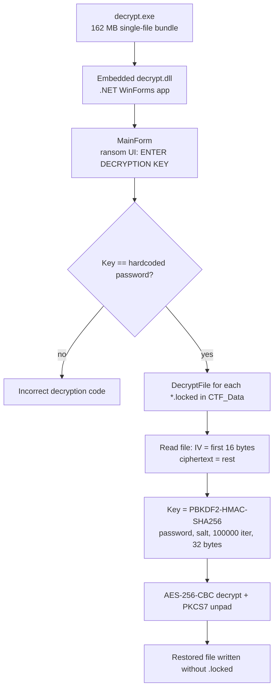
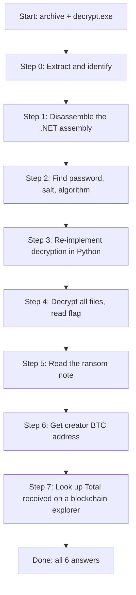

# IDG Ransomware – Forensic CTF Lab: Flow & Architecture

A start-to-finish write-up of how the lab was solved, including the tools used, the data flow, and the dead ends.

> **Safety:** the sample is ransomware-themed. Do static analysis first. Run `decrypt.exe` only in an isolated VM with snapshots and no network.

---

## 1. Questions and final answers

| # | Question | Answer |
|---|----------|--------|
| 1 | Extension of the locked files | `.locked` |
| 2 | Bitcoin address of the creator | `bc1qzwx37vuum7fakntjxm6wm7lwlh7f5z45fv98fq` |
| 3 | Encryption algorithm | AES-256-CBC (PKCS7 padding, key from PBKDF2-HMAC-SHA256, 100,000 iterations) |
| 4 | BTC received by that address | `0.00037130` |
| 5 | Decryption key | `IDG-RANSOM-85f830876bc146926679783a62827193` |
| 6 | Flag | `FLAG{CTF_SAFE_RANSOMWARE}` |

---

## 2. Lab layout

```
Forensic/
├── IDG-Ransomware.7z      # challenge archive (46 MiB)
├── decrypt.exe            # 162 MB single-file .NET app (the "decryptor")
├── CTF_Data/              # encrypted evidence
│   ├── evidence.txt.locked
│   ├── flag.txt.locked
│   ├── secret.txt.locked
│   ├── sample.pdf.locked
│   └── សេចក្តីជូនដំណឹង.pdf.locked   # Khmer "Notice" (ransom note)
├── idg/                   # extracted archive (same content)
├── work/                  # analysis output (decrypt.dll, decrypt.il, script)
└── solved/                # decrypted files
```

---

## 3. Architecture of the malware sample

`decrypt.exe` is a **.NET single-file bundle**. That is why `strings` shows thousands of framework strings (WPF, System.*, resources). The real code is one embedded assembly, `decrypt.dll`, a WinForms app that mimics a ransom screen.



### Crypto parameters (recovered from `decrypt.dll`)

| Item | Value |
|------|-------|
| Password / "key" | `IDG-RANSOM-85f830876bc146926679783a62827193` |
| Salt | `CTF-SAFE-SALT-2026` (UTF-8) |
| KDF | `Rfc2898DeriveBytes`, SHA-256, 100,000 iterations, 32-byte output |
| Cipher | AES-256, CBC mode, PKCS7 padding |
| IV | first 16 bytes of each `.locked` file |
| Ciphertext | remaining bytes |

---

## 4. Solving flow (start to finish)



### Step 0 – Extract and identify

```bash
7z x IDG-Ransomware.7z -oidg
file decrypt.exe            # PE32+ executable, x86-64, GUI
sha256sum decrypt.exe
exiftool idg/decrypt.exe    # Internal Name: decrypt.dll  -> .NET assembly inside
ls CTF_Data/                # all files end in .locked  -> Q1
```

**Q1 answer:** the extension is `.locked`.

### Step 1 – Get the .NET code out

The framework noise in `strings` hides the real logic, so extract the assembly and disassemble it.

```bash
monodis work/decrypt.dll > work/decrypt.il      # CIL disassembly
monodis --userstrings work/decrypt.dll          # every string literal
```

`--userstrings` was the key command. It lists all `ldstr` literals, including ones a plain grep misses.

### Step 2 – Find the password, salt and algorithm

From the user-strings heap:

- `IDG-RANSOM-85f830876bc146926679783a62827193` → the decryption key (**Q5**)
- `CTF-SAFE-SALT-2026` → the PBKDF2 salt
- Ransom UI text: "encrypted with AES-256" → algorithm (**Q3**)
- Also strings like `Incorrect decryption code.` and `Invalid CTF file.`, which confirm the key check and file validation.

### Step 3 – Re-implement in Python

```python
#!/usr/bin/env python3
import hashlib
from pathlib import Path
from Crypto.Cipher import AES
from Crypto.Util.Padding import unpad

PASSWORD = b"IDG-RANSOM-85f830876bc146926679783a62827193"
SALT = b"CTF-SAFE-SALT-2026"

def decrypt_file(src: Path, dst: Path):
    blob = src.read_bytes()
    iv, ct = blob[:16], blob[16:]
    key = hashlib.pbkdf2_hmac("sha256", PASSWORD, SALT, 100_000, dklen=32)
    dst.write_bytes(unpad(AES.new(key, AES.MODE_CBC, iv).decrypt(ct), 16))

out = Path("solved"); out.mkdir(exist_ok=True)
for f in Path("CTF_Data").glob("*.locked"):
    decrypt_file(f, out / f.name[:-len(".locked")])
```

### Step 4 – Read the evidence files

```bash
cat solved/evidence.txt solved/secret.txt solved/flag.txt
```

| File | Content |
|------|---------|
| `evidence.txt` | "The attacker encrypted these files. Find the decryption code hidden inside the executable." |
| `secret.txt` | "Congratulations! You found the CTF secret." |
| `flag.txt` | `FLAG{CTF_SAFE_RANSOMWARE}` → **Q6** |
| `sample.pdf` | harmless lorem ipsum PDF (decoy) |

### Step 5 – Ransom note and the creator's Bitcoin address

The Khmer notice (`សេចក្តីជូនដំណឹង.pdf`, "Notice") is the ransom note. In this lab, the decrypted file was **not** a valid PDF (see Section 6), so the note text was provided through the challenge hint. The note contains:

- Amount: `0.05 BTC`
- Contact: `ethical.hacker999@proton.me`
- Victim ID: `LOCK-9XK-8421-TR4`
- Payment address: **`bc1qzwx37vuum7fakntjxm6wm7lwlh7f5z45fv98fq`** → **Q2**

### Step 6 – Blockchain lookup (Q4)

The question asks for the amount **received**, not the balance. Use the public mempool.space API:

```bash
curl -s https://mempool.space/api/address/bc1qzwx37vuum7fakntjxm6wm7lwlh7f5z45fv98fq | python3 -c "
import sys, json
d = json.load(sys.stdin)
c = d['chain_stats']
print('%.8f' % (c['funded_txo_sum']/1e8))
"
```

Result: `funded_txo_sum = 37130` satoshis, one transaction, nothing spent.

37,130 ÷ 100,000,000 = **0.00037130 BTC** → **Q4**

---

## 5. Tooling summary

| Purpose | Tool |
|---------|------|
| Archive extraction | `7z` |
| File identification / metadata | `file`, `sha256sum`, `exiftool` |
| Strings | `strings` (`-el` for UTF-16) |
| .NET disassembly | `monodis` (`--userstrings` is the useful one) |
| Decompiler (optional, nicer output) | ILSpy / dnSpy / `ilspycmd` |
| Decryption | Python + `pycryptodome` |
| PDF inspection | `pdftotext`, `pdfimages`, `qpdf`, `zbarimg` |
| Entropy / structure | `ent`, `xxd`, custom Python |
| BTC lookup | mempool.space API, blockchair.com |

---

## 6. Dead ends and lessons learned

| Issue | What happened | Lesson |
|-------|---------------|--------|
| BTC address not in the binary | Greps of `decrypt.exe`, `decrypt.dll` and the IL found no wallet | `--userstrings` showed the app has only UI text, the password and the salt. The address lives in the ransom note, not the code. |
| Regex noise | A loose Base58 regex matched hundreds of 64-char hex strings | Filter out pure hex (`grep -v '^[0-9A-Fa-f]*$'`) when hunting addresses. |
| Khmer "PDF" unreadable | Decrypted with valid padding, but the output is random (entropy ≈ 7.9997, no `%PDF`, no repeated blocks, chi² ≈ 261, not zlib/XOR) | A valid padding check proves the key worked. The file is probably random filler or a second layer. Don't chase it forever. |
| Shell in wrong directory | Commands failed with "No such file" | Check `pwd` before running relative paths. |
| Binary bundle noise | 162 MB of .NET runtime strings | Extract the embedded assembly instead of grepping the bundle. |

---

## 7. Method checklist (reusable for similar labs)

1. Extract archives; run `file`, hashes and `exiftool`. Identify language and packer.
2. For .NET: disassemble and dump **user strings** (hardcoded keys, salts, URLs).
3. Identify the crypto from API calls and UI text; note the mode, KDF, IV handling.
4. Re-implement the decryption outside the malware. Never trust the binary on your host.
5. Read every decrypted artifact (text files, notes, metadata).
6. Pull IOCs (wallets, emails, onion URLs) from the ransom note.
7. Enrich IOCs on public sources (blockchain explorer) and record exact formats.
8. Document answers with the evidence for each one.

---

## 8. IOC summary

| Type | Value |
|------|-------|
| BTC wallet | `bc1qzwx37vuum7fakntjxm6wm7lwlh7f5z45fv98fq` |
| Ransom demand | 0.05 BTC |
| Total received on chain | 0.00037130 BTC (1 tx, 37,130 sats) |
| Contact email | `ethical.hacker999@proton.me` |
| Onion site | `av7twlwdnp5tiu4sb2rullc6yd4uz5bmhrdrvmcdmn74wlfwzqb4utqd.onion` |
| Victim ID | `LOCK-9XK-8421-TR4` |
| Group name in note | IDG Ransomware Group |
| Password / key | `IDG-RANSOM-85f830876bc146926679783a62827193` |
| Salt | `CTF-SAFE-SALT-2026` |
| `decrypt.exe` SHA-256 | `25629ae8697003779eec0f11e8feeca5bc4ed0978ddf055d023d74795c692fe5` |
