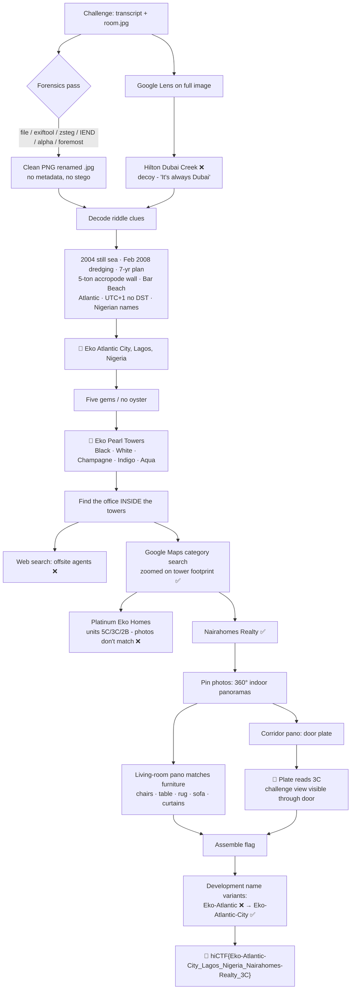
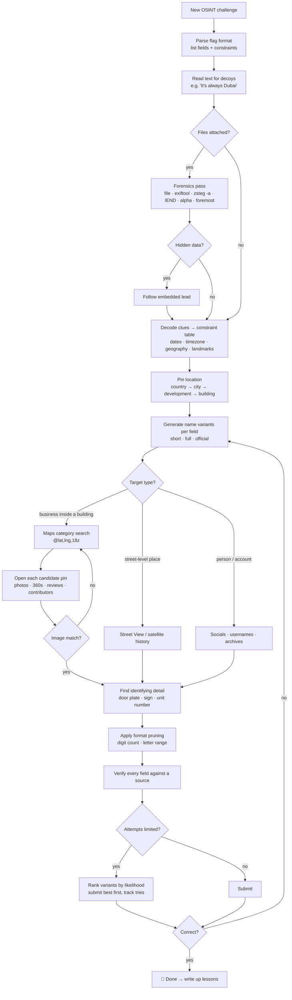
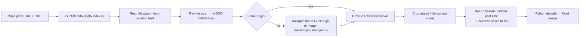

# Low Tide Ledger — OSINT Writeup + Skill Improvement Notes

**CTF:** hiCTF · **Category:** OSINT · **Points:** 155 · **Author:** Hidden Investigations
**Flag:** `hiCTF{Eko-Atlantic-City_Lagos_Nigeria_Nairahomes-Realty_3C}`

Flag format: `hiCTF{Development_City_Country_Agency_Room}`

- Development = reclaimed city project
- City = metropolis
- Country
- Agency = "original business name"
- Room = floor digit + door letter from the plate

---

## Solve Flow (overview)



---

## Part 1 — The Writeup

### What we were given

- A recovered "call" transcript between Imani and Dayo, full of riddle clues.
- `low-tide-ledger.zip` containing a single `room.jpg`. It was actually a **PNG renamed to .jpg** (RGBA, 1246×832).
- The photo shows a living/dining room: tan leather sofa with magenta cushions, cognac leather shell dining chairs, a wood table, a grey shag rug, and a big overexposed window with pale curtains.

### Step 0 — Ignore the decoy

Google Lens on the full image returned **Hilton Dubai Creek** results. The transcript even mocks this ("So it's Dubai. It's always Dubai."). A generic interior plus a whole-image reverse search gives you a generic luxury-apartment match, so it was a red herring.

### Step 1 — File forensics (dead end, but it had to be ruled out)

```bash
file room.jpg                       # PNG image data, not JPEG
exiftool -a -G1 room.jpg            # no GPS, camera, author, comments
cp room.jpg room.png
zsteg -a room.png                   # only noise: "OpenPGP Secret Key", "AIX core file" = random magic matches
pngcheck -vt room.png               # clean structure
tail -c 200 room.png | xxd          # ends cleanly at IEND, nothing appended
python3 -c "from PIL import Image; print(set(Image.open('room.png').getchannel('A').getdata()))"  # {255}
foremost -i room.png -o carved      # only carves the PNG itself
```

**Conclusion:** no stego, no metadata, so it's pure OSINT.

Note for next time: zsteg "file:" hits like OpenPGP / AIX core / PGP sub-key are almost always false positives. A real payload shows up as readable text or a consistent file type in the low bit planes (`b1,rgb,lsb`).

### Step 2 — Decode the riddle into a location

| Clue | Meaning | Result |
|---|---|---|
| "The summer Athens lit its flame, the ground… was still open sea" | Athens Olympics 2004, land didn't exist yet | Reclaimed after 2004 |
| "Orbit doesn't flatter" | Check satellite history | Land reclamation |
| "Dubai wouldn't let me face the Atlantic" | Atlantic coast | West Africa / Morocco |
| "My clock matches Paris in winter and ignores the summer" | UTC+1, no DST | West Africa Time (Nigeria) |
| "Dredgers showed up half a year before Beijing's cauldron" | Aug 2008 minus 6 months | Dredging started Feb 2008 |
| "Planners promised seven years of dredging" | 7-year dredging plan | Eko Atlantic's announced plan |
| "Wall… stacked from five-ton concrete blocks, cast beside the water" | Accropodes, 5 t each, made on site | "Great Wall of Lagos" |
| "The old public beach is somewhere under my feet" | Bar Beach, Victoria Island | Eko Atlantic sits on it |
| Speaker names Imani / Dayo | Nigerian names | Supports Lagos |

→ **Eko Atlantic City, Lagos, Nigeria.**

⚠️ **The flag needed `Eko-Atlantic-City`, not `Eko-Atlantic`.** The official name is "Nigeria International Commerce City", the common short name is "Eko Atlantic", and the flag used the full popular name. This one detail made several correct-agency/correct-room attempts fail.

### Step 3 — "Five gems that never touched an oyster"

That's a cluster of towers named after pearls that aren't real pearls: **Eko Pearl Towers** (Black Pearl, White Pearl, Champagne Pearl, Indigo Pearl, Aqua Pearl). Only Black and Champagne are completed, and both are called Tower A/B in listings.

### Step 4 — "Find the office" (where most of the time went)

"Not a hotel. A small office that sells homes, tucked inside a cluster of towers."

Web search for agencies listing Eko Pearl units gave dozens of agents with offices elsewhere (Metrocity, News Realty, Joossa, etc.). All noise.

**What actually worked: Google Maps, zoomed to the tower footprint, with a category search.**

```
https://www.google.com/maps/search/real+estate+agency/@6.4093,3.4103,18z?hl=en
```

This lists businesses whose pin is *on* the towers:

- Platinum Eko Homes — real estate rental agency
- **Nairahomes Realty** — at Eko Pearl Towers ← the answer
- Olive Luxury Apartments, Abdulsworld, Eko Atlantic Shortlet Apartments, etc.

**Wrong turn:** Platinum Eko Homes looked perfect. Their site names units in the exact flag format (`5C Tower B`, `3C Tower B`, `2B Tower B`). But none of their listing photos matched our furniture. I also chased an "original name" rabbit hole via Booking.com, where the same Nairahomes apartments were once listed under "Nairadesigns Innovations". The flag simply wanted the Maps business name: **Nairahomes Realty**.

### Step 5 — "Find my room… by the furniture"

The Nairahomes Realty Maps pin has **11 photos**, mostly **360° indoor panoramas**. That's why the challenge image looks washed out and slightly warped: it's a crop from an equirectangular pano.

One pano shows the exact match: cognac shell chairs, wood table, grey shag rug, tan leather sofa with red cushions, curtained balcony door.

### Step 6 — "The plate by the door is the only honest thing"

The inside-door view had no number. The **corridor panorama** (wood-panelled building hallway, apartment door open) shows:

- an acrylic door plate reading **3C**
- through the open door, *the exact composition of the challenge photo*

→ **Room = 3C** (floor 3, door C). Eko Pearl has 4 flats per floor, so letters A–D fit.

### Final flag

```
hiCTF{Eko-Atlantic-City_Lagos_Nigeria_Nairahomes-Realty_3C}
```

### Wrong submissions (for the record)

| Flag | Why it failed |
|---|---|
| `…Eko-Atlantic_…_Platinum-Eko-Homes_3C/5C/2B` | Wrong development name and wrong agency |
| `…Eko-Atlantic_…_Nairadesigns-Innovations_3C` | Wrong development name, and over-read "original name" |
| `…Eko-Atlantic_…_Platinum-Shoreline_3C` | "Platinum Shoreline" was just a Maps reviewer, not a business |
| ✅ `…Eko-Atlantic-City_…_Nairahomes-Realty_3C` | Correct |

---

## Part 2 — Notes for Claude Code: Improving the OSINT Skill

These are lessons from this solve, written as rules a future OSINT skill should follow.

### A. Methodology rules

1. **Decode every riddle clue into a hard constraint before searching.** Build a table of clue → meaning → constraint. Dates ("Athens flame", "Beijing cauldron") turn into year and month. A timezone ("Paris in winter, no summer") turns into UTC+1 without DST.
2. **Treat whole-image reverse search on generic interiors as a decoy.** Crop distinctive objects instead (furniture, fixtures, window grids) and use Yandex/Bing, not only Google Lens.
3. **Rule out file forensics fast, then move on.** Run `file`, `exiftool`, `zsteg -a` (renamed PNGs!), a check for data after IEND, the alpha channel, and `foremost`. Ignore zsteg "file:" magic false positives.
4. **"Find the office inside the building" means Google Maps first, not web search.** Zoom to the building footprint (`/@lat,lng,18z`) and run category searches (`real estate agency`, `realtor`, `estate agent`). Web search returns agents who *list* units there, not businesses *located* there.
5. **"Find the room by the furniture" on a business pin means check the pin's Maps photos, especially 360° panoramas.** Challenge images are often crops of user-uploaded indoor panos, which explains the washed-out, warped look.
6. **"The plate by the door" means look for a corridor/entrance pano** showing the unit number on the outside of the door.
7. **Use flag-format constraints to prune.** "Floor digit" means a single digit, so floors 1–9 only. Four flats per floor means letters A–D.
8. **Name variants matter.** For the Development field, generate variants before submitting: short name, full popular name, official name (`Eko-Atlantic`, `Eko-Atlantic-City`, `Nigeria-International-Commerce-City`). Don't assume the short name.
9. **Don't over-interpret "original business name".** Default to the business name as it appears on the platform the trail came from (here, the Maps pin). Only go deeper into rebrands if that fails.
10. **Verify a lead before suggesting a flag.** "Platinum Shoreline" was suggested from a reviewer name without checking the profile. That was a wasted attempt. Always open the profile or page first.
11. **Track submitted flags and ask about the attempt limit early.** Keep a crossed-off list so variants aren't repeated.

### B. Browser technique (built-in browser pane, hidden/minimized)

When the desktop app's browser pane is hidden, pages don't paint: clicks and screenshots fail with "page did not finish rendering". `get_page_text` and `javascript_tool` still work. Workarounds that proved reliable:

- **Maps search lists render to text fine.** Use `get_page_text` on `/maps/search/...` URLs.
- **Maps place pages:** wait about 5 s in JS, then read `document.querySelector('[role=main]').innerText`.
- **Maps photo gallery without rendering:** open the place with `!10e5` in the data param, then programmatically click each `[data-photo-index="N"]` element with `el.click()`. Read the photo URL out of `location.href`: it's the `!6s<url>` parameter, URL-decoded.
  ```js
  for (let i = 0; i < 10; i++) {
    document.querySelector(`[data-photo-index="${i}"]`).click();
    await new Promise(r => setTimeout(r, 2500));
    const m = decodeURIComponent(location.href).match(/!6s(https:\/\/lh\d\.googleusercontent\.com\/[^!]+)/);
    console.log(i, m && m[1].split('=')[0]);
  }
  ```
- **Get full-resolution panoramas** by rewriting the size suffix on googleusercontent URLs: `=w8000-h4000-k-no` gives the full equirectangular image. Then crop the region of interest (door, plate) in a canvas.
- **CORS:** `fetch()` of image CDNs from another origin fails. Navigate the tab to the CDN origin first (e.g. `storage.googleapis.com`, `cf.bstatic.com`), then fetch same-origin. Or use `new Image()` with `crossOrigin='anonymous'` on googleusercontent, which allows it.
- **Getting images back to the workspace:** the sandbox shell usually can't reach image CDNs (allowlist). Draw images into an `OffscreenCanvas`, export a JPEG, and return base64 from `javascript_tool`. To keep a big base64 out of the context window, **pad the return value past the tool's size limit** (`btoa(s)+'|'+'.'.repeat(90000)`) so the harness saves it to a file. Then decode with Python and `Read` the image.
- **Contact sheets beat one-by-one viewing.** Tile 10–30 thumbnails with labels into one canvas, then view once.
- **SPA listing sites** (e.g. Reeka-powered booking pages) load photos client-side. Render the page and scrape `img.currentSrc`, or load the routes in hidden iframes.
- **Wayback Machine** may be offline. Have a fallback (Booking/aggregator mirrors, Instagram, Facebook).

### C. Sources ranked by usefulness for "find the unit in a building" challenges

1. **Google Maps** — category search at the building, the pin's photos/360s, reviews, and contributor profiles
2. **The business's own site** — unit naming conventions (e.g. "3C Tower B")
3. **Booking.com / Airbnb listing names** — historical names and rebrands, often still in search results after the listing closes
4. **Property portals** (nigeriapropertycentre, propertypro) — lots of listings, mostly offsite agents, low signal for "office inside"
5. **Generic web search** — good for decoding riddle facts (dates, sea walls, dredging), poor for locating businesses

### D. Generic decision flow for the skill (image + riddle OSINT)



### E. Hidden-browser photo extraction flow



### F. Suggested skill checklist (copy into the skill)

```
[ ] Decode all clues into constraints (table)
[ ] Note decoys explicitly mentioned in the challenge text
[ ] Forensics pass: file / exiftool / zsteg -a / IEND tail / alpha / foremost
[ ] Pin the location (city, development, building)
[ ] List name variants for each flag field
[ ] Maps: category search zoomed on the building footprint
[ ] Maps: open each candidate pin -> photos (360s!) -> reviews -> contributors
[ ] Match furniture/fixtures against pin photos (contact sheet)
[ ] Find the door plate / unit number in a corridor shot
[ ] Apply flag-format pruning (digit count, letter range)
[ ] Verify every lead before proposing a flag
[ ] Track submitted flags; ask about attempt limits
```
